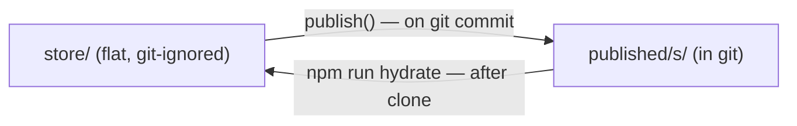

# rim-store — the store, published, and getting a working tree

rim has **two on-disk projections of the same nodes**. Understanding the split is the
whole skill; the commands fall out of it.

## Four senses of "store"

"Store" gets overloaded — four distinct things wear the name:

- **working store** — `store/<id>.mdx`, the flat files the app actually reads/writes on
  every edit. Git-ignored.
- **canonical index** — the SQLite mirror (`store/.rim.db`) the server queries against;
  derived from the working store, never hand-edited.
- **private store** — `store/.private/`, a mounted-in external repo of nodes that load and
  render normally but are hard-excluded from every export target. See below.
- **exports** — `published/` and the per-project export dirs: the organized, git-tracked
  reprojection of the working store, produced by `export()` (the route is still named
  `/api/publish` — see Vocabulary).

## Vocabulary: export vs sync

- **export** — reproject the working store's nodes into `published/` (and per-project
  export dirs). This is what `POST /api/publish` (and its `/api/export` alias) does.
- **sync** — commit + push an *external* export repo so its clone stays current. This runs
  from the git pre-commit hook (`server/publish-cli.mjs`), after the export step, for every
  external target.

Both happen back-to-back on every commit, which is why "publish" used to mean either —
`/api/publish` is kept only as the legacy route name; docs and output say export/sync.

## The two filesystems

| | `store/` | `published/` |
|---|---|---|
| **role** | the working store the app reads/writes | the organized export that ships in git |
| **layout** | flat: `store/<id>.mdx` | by kind: `published/<kind>s/<id>.md` |
| **in git?** | **no** — git-ignored (`.gitignore`: `/store/`) | yes — committed + pushed |
| **written by** | the app (every edit) | `publish()` on commit |

A clone therefore has **no `store/`** — only `published/`. Start the server against an
empty store and `/api/tree` is empty (5→0 roots). The server warns on boot:
`store/ is empty — run npm run hydrate`.

## Why the flat reprojection is lossless

The tree is **not** built from directory nesting. `walk(STORE)` recurses and collects every
`.md`/`.mdx`; the forest is then assembled by linking each node to the node whose `id`
matches its `parent:` frontmatter. **Structure lives in `parent:`, not in the folder path.**

That is the key property: a flat `store/<id>.mdx` reprojection renders *identically* to a
hand-nested tree. `publish()` writes each node's full raw content (frontmatter + body)
verbatim, so the round-trip is lossless — no field is dropped, no nesting is needed.



## Getting a working store (the special startup command)

Hydration is **explicit**, not automatic on every boot — you only reproject when the store
is missing or you want to backfill from the export. After cloning:

```sh
cd app
npm install
npm run hydrate     # reproject published/ → store/  (prints "hydrated … — N nodes")
npm run dev         # http://localhost:5180 — now serves the full tree
```

`npm run hydrate` runs `importPublished()`:

- **Additive** — it never clobbers a node `store/` already has (`if (!exists) write`), so
  re-running only fills gaps. Safe to run any time.
- Creates `store/` if absent.
- Skips index `README.md` files; imports every `published/*/*.md` as `store/<id>.mdx`.
- Same op as `POST /api/import` on the running server — the CLI just works without a server.

The reverse, `publish()` (store → published), runs automatically from the git pre-commit
hook (`server/publish-cli.mjs`) and on `POST /api/publish`. You rarely call it by hand.

## The private store mount

`store/.private/` is a fourth location: an external repo's `store/` mounted in, whose nodes
load and render like any other but are hard-excluded from every export target (`export()`
skips anything under `.private/` before target routing, regardless of `publish:` fields).

Convention: a private store clone lives at `~/.rim/stores/<name>`, a git repo whose own
`store/` subdir is the mountable content. Mount it with a symlink:

```sh
ln -s ~/.rim/stores/<name>/store store/.private
```

`npm run setup` does this automatically when exactly one `~/.rim/stores/<name>` exists (and
prints guidance to set one up otherwise) — see README's Run section.

## Gotchas

- **Don't commit `store/`** — it's intentionally git-ignored; `published/` is the shared
  artifact. Secrets (`store/.settings.json`, `store/.history.db`, `store/.rim.db`) are
  ignored too — never force-add them.
- **Empty tree after clone = you skipped `npm run hydrate`.** That's the one manual step.
- **another project never lives in rim's store.** A new project is a **separate store**:
  its own git repo at `~/.rim/stores/<name>` (create it with `rim newstore <name>
  --prefix PRJ`), served by its own rim instance (`STORE_DIR=~/.rim/stores/<name>/store
  npm run dev -- --port <port>`; `RIM_URL` points the CLI at it). rim's own `store/` and
  `published/` hold only rim's nodes.
