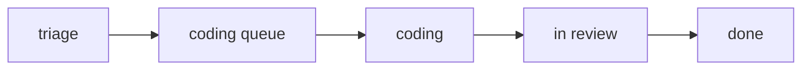

# rim

rim tracks work as a tree of **nodes** (`store/*.mdx` / `*.md`), rendered by a
React+Vite app (`app/`) whose Vite middleware *is* the backend. Each node is a
markdown/MDX document with YAML frontmatter; the body is authored and edited inline
in the viewer.

## Run it

```
cd app && npm run dev      # the viewer + its middleware API on one port
```

The store path defaults to `../store` (override `STORE_DIR`). Secrets
(`store/.settings.json`, `store/.history.db`) are gitignored — never commit them.

## The node model

Frontmatter fields that matter:

- `id` — stable slug (also the filename stem; `[text](some-id.mdx)` links resolve by it)
- `code` — human handle and URL (`/RIM-7`); **prefix = project** (`RIM-`, `PRJ-`)
- `kind` — one of the 11 kinds registered in `app/src/kinds.ts` (the registry): `scope` |
  `execution` | `spike` | `build` | `spec` | `overview` | `doc` | `component` |
  `workspace` | `skill` | `term`
- `parent` — the parent node's `id` (omit → a top-level **project root**)
- `status` — `triage → coding queue → coding → in review → done` (the agent drives all of it; the operator approves only a **scope's** acceptance criteria)
- `depends_on: [ids]` — DAG edges; an unmet dep shows **blocked** in the tree
- `pinned`, `comments`, `started_commit`, `commit`, `view`, `description`, `repo`

A node with an unresolved comment shows a **discussion** chip (overrides all states).

## The methodology is OUGHT — rim is the source of truth

The method is specified by **RIM-192/OUGHT**, the rim-native methodology scope, and by
its installable `kind: skill` nodes:

- `OUGHT-9` / `methodology`
- `OUGHT-10` / `planning`
- `OUGHT-11` / `ticketing`
- `OUGHT-12` / `building`
- `OUGHT-13` / `orient`
- `OUGHT-14` / `grill`
- `OUGHT-15` / `diagramming`
- `OUGHT-16` / `recipe`

Install them through rim's skill installer (`/api/skills/install`) for an agent target
such as `codex` or `claude-code`. The older `private-skills` / hypermemetic skills are
the Linear-era ancestor: useful lineage, not the current source of instruction.

**Repo skills vs skill nodes — two different things named "skill" (TIDY-18).** A
**repo skill** is this file and its neighbors under `.claude/skills/<name>/SKILL.md` —
a file on disk, loaded by an agent harness (Claude Code, Codex) to know *how to drive a
tool* (this file teaches an agent how to drive rim). A **skill node** is a `kind: skill`
store node (e.g. `OUGHT-9`/`skill-methodology`) — a *tracked, installable capability*
whose body is generated onto disk (`installSkills()` → `~/.claude/skills/<name>/SKILL.md`
or the equivalent target path) to become a repo skill for whichever agent installs it.
So: skill nodes are the source; repo skills are one rendering of a skill node, installed
into an agent's own skill directory. `retired: true` on a skill node (the METHODOLOGY-*
family superseded by OUGHT-9..16) excludes it from `listSkillNodes()`/install/export —
it stops being offered as a repo skill — while the node itself stays in the tree as
lineage with an `ancestor:` pointer to its successor.

**rim is the source of truth.** The node body (`store/*.mdx`) is the ticket description,
the canonical document, and the artifact we iterate in place.

The two invariants carry over unchanged: **the human decides, the agent executes, the
ticket is the interface**; and the **linguistic belief state** — every node carries its
*value* (the contract, the criteria, the finding) AND the *evidence* that justifies it.

### Methodology mapping — inherited term → rim
| inherited methodology term says… | …in rim |
|---|---|
| "Linear is the source of truth" | the **node body** (`store/<id>.mdx`) is — iterate in place |
| the scope/execution **ticket description** | the node **body** (MDX) |
| states `new → coding queue → coding → in code review → … → done` | `triage → coding queue → coding → in review → done` (+ derived `blocked` / `discussion`) |
| `canceled` only **WITH a pointer** | cancel/supersede **with a pointer** to the survivor — never silently drop |
| `Provides` / `Consumes` contract edges | body `Provides:` / `Consumes:` **+ frontmatter `depends_on: [ids]`** — the machine-readable edge that drives the **blocked** overlay |
| a thematic sub-prefix under a project (`SEED-`, `SEC-`) | a **`subscope:`** on the bridge node; children take `<PREFIX>-N` codes |
| a Linear **project** | a **separate store** — `rim newstore` ("Adding a NEW project" below) |
| evidence pinned by commit-permalink | same — plus `started_commit` / `commit` stamped on the node |
| **human ratifies at every fork (`new` → onward)** | **rim override (RIM-192/OUGHT):** the agent runs **autonomously**; the operator ratifies exactly **one** thing — a **scope's** acceptance criteria (see "The single approval gate") |

The last row is the **one deliberate divergence** — rim reduced the per-fork ratify gate to
a single scope-level sign-off. Everything else is the methodology, unmodified.

Every node is one of the kinds below; every status move follows the lifecycle; every
forward move past `coding` is checked by the **gates**.

## Node kinds & how to add work

Kinds + the fork are **defined by the methodology** (read `/methodology` → "node kinds");
the table below maps them onto rim and adds rim's **view-kinds**. The fork is unchanged:
one execution → *small enough for one agent in one diff?* yes → **build**; no → a **DAG of
sub-executions**, each re-entering the fork; **spikes** answer the unknowns that shape them.

| kind | what it is (in rim) |
|---|---|
| `scope` | the what/why; its entry point; carries the operator's `<Criterion>`s; never canceled |
| `execution` | holds a DAG of children; owns no work itself |
| `spike` | resolves ONE unknown; binary pass; output is evidence |
| `build` | ONE diff, one agent, buildable from the ticket alone |
| `spec` | a high-level feature as a statement — requirements + the work that produced it |
| `skill` | a capability you track — not gated like a build/spike |
| `term` | a glossary entry — accrues from `[[term]]` usage; not work (GLOSS) |
| `overview`·`doc`·`component`·`workspace` | **rim view-kinds** — parent summary · prose · runtime component · view filter |

All 11 kinds above are rows in `app/src/kinds.ts`, the registry.

**To add work:** create `store/<id>.mdx` with frontmatter — `code` (**mint** it under the
project prefix `RIM-`/`PRJ-`, or a `subscope:` prefix `<PREFIX>-N`), `id`, `kind`, `title`,
`parent` (owning execution's id), `status: triage`, and **`depends_on: [ids]`** for any
unmet dependency (node ids — drives the **blocked** overlay). Body = a **mermaid diagram** +
**acceptance criteria** (build), or **question + pass condition** (spike). For a program,
make an `execution` + its spikes/builds; the operator ratifies the **scope's** criteria, the
agent drives the rest. To group a thematic cluster, put `subscope: <PREFIX>` on the bridge
node and give its children `<PREFIX>-N` codes (e.g. `IDEN-`, `SEC-`).

If the ticket exists because we found a miss, make it a **reconciliation ticket mode** by
adding body fields:

```mdx
<ReconciliationMissed>What we missed.</ReconciliationMissed>
<ReconciliationWhy>Why we missed it.</ReconciliationWhy>
<ReconciliationSolving>How this ticket resolves it.</ReconciliationSolving>
```

Only `build` and `execution` tickets may enter reconciliation mode. Any one reconciliation
field means the ticket is in that mode, and validation requires all three. This is the
general direction for ticket modes/types: modes are schema-registered overlays on a base
kind; frontmatter identifies the node, and the body satisfies type/mode structure.

## Status lifecycle



| status | means | who moves it |
|---|---|---|
| `triage` | contract written (or idea-grade) | the agent |
| `coding queue` | unblocked, ready to build | the agent |
| `coding` | in progress — stamps `started_commit` at HEAD | the agent |
| `in review` | implemented + committed — stamps the work `commit` | the agent |
| `done` | criteria met (attested + tests pass) | the agent — **except a scope's acceptance gate** |

Two **overlay** states are *derived*, not set: **blocked** (a `depends_on` isn't done)
and **discussion** (an unresolved comment — overrides every other chip). Never silently
drop a node — cancel/supersede *with a pointer* to the survivor.

## The single approval gate (RIM-192/OUGHT)

**The agent runs autonomously.** It queues, builds, reviews, and marks sub-issues
(build/spike/execution/doc) **done** on its own — no per-ticket human approval — provided
the automated gates pass (criteria attested via `test=`, provenance captured). The old
per-ticket ratify-and-accept gates are gone; they were friction, not safety.

**The operator approves exactly one thing: a scope's acceptance criteria.** A
**scope carries its own `<Criterion>`s** — the contract for the whole body of work — and a
scope is `done` only when its children are done **and** its criteria are attested. The
agent never attests a scope's criteria; **the operator does** (their single sign-off). So
the agent drives everything beneath to done, and the scope waits for the operator there.
(This is enforced in `rollupWalk` + the acceptance gate — a scope can't roll up to done on
children alone.)

**Commit provenance:** → `coding` stamps `started_commit`; → `in review`/`done` stamps
the work `commit` (re-stampable as more land). Each ticket records the exact commits
that built it — so move status as you commit each step.

## Gates (enforced on forward transitions; surfaced as ⚠ violations)

A node can't advance past a gate it fails — `setStatus` returns **422** and the violation
shows as a detectable **violation**. Each gate carries its *why* (the linguistic belief state —
the rule travels with its reason). Source of record: `app/server/store.mjs` + `bootstrap()`.

- **Kind-schema.** A node has the fields its kind requires, *derived from the body*: a
  build/spike/scope/execution needs a **mermaid diagram**; a **build** needs `<Criterion>`
  acceptance criteria; a **spike** needs a `<Question>`; a **spec** needs `<Requirement>`s.
- **Ticket modes.** A schema-registered mode layers extra body-derived required fields on
  top of a base kind. Reconciliation mode is build/execution plus
  `<ReconciliationMissed>`, `<ReconciliationWhy>`, and `<ReconciliationSolving>`.
- **Acceptance.** To reach `in review`/`done`, **every `<Criterion>` must be attested** —
  `test=` (an automated test) or `attest=` (a written justification). A bare checkbox does
  not count; the claim needs evidence. (Completion = every criterion maps to a *test*.)
- **Provenance.** An active node (`coding`/`in review`/`done`) must have a work **branch**
  — its own or inherited from its execution — so it links to a worktree. Drift (a branch
  that no longer resolves; a branch with work that no node claims) is the GIT scope
  (RIM-191). Never record a misleading commit; omit and flag instead.
- **Component-in-action.** A `kind: component` is complete only when **demonstrated** —
  invoked in a node body or via `demo:`.
- **Error vs violation.** An **error** is broken (won't parse/render); a **violation** is
  detectable-but-renders (a gate violation). `/api/health` and `/api/errors?severity=`
  separate them — surfacing is one ⚠.

## Turn-taking — whose move is it

Work is either **needs-you** (an open human `<Question>`, an operator-audience comment, or a
scope-level ratify/accept gate) or in the **machine queue** (everything the machine can advance
now). The queue is *what's next*, not *what's open*: a node with un-done children isn't poppable
— its children are. Terminal nodes (`done`/`canceled`/`deferred`) do not re-enter Needs You from
stale comments. Non-scope `in review` work with met criteria is machine-turn `complete`; the
agent moves it to `done`. The operator's default approval gate is scopes.

## Adding a NEW project

**A new project is a separate store.** rim's own store holds rim's nodes (`RIM-` and its
subscopes); every other project gets its **own store** — its own git repo under
`~/.rim/stores/<name>`, served by its **own rim instance**. Nothing in rim's store
references it. There is one command:

```sh
rim newstore <name> --prefix PLX [--repo ~/dev/thing] [--port 5181]
```

It scaffolds `~/.rim/stores/<name>/` (git repo: `.gitignore`, `README.md`,
`store/<name>.mdx`), creates the **project root** — a `kind: scope` node `<PREFIX>-1`
with no `parent`, a starter diagram, and unattested operator `<Criterion>`s — makes the
initial commit, and prints how to serve it:

```sh
cd <rim>/app && STORE_DIR=~/.rim/stores/<name>/store npm run dev -- --port <port>
RIM_URL=http://localhost:<port> rim health        # point the CLI at that instance
```

Then **add work** under the root with `<PREFIX>-N` codes and `parent:` set. No workspace
node is needed — the whole store *is* the project. Use `subscope:` for thematic clusters
*within* a project; never put another project's nodes in rim's own store.

**A project already living in a shared store** moves out with:

```sh
rim migrate <ROOT|CODE|id> [name] [--store <src-dir>] [--dry]
```

It migrates only a **root** (no `parent`) — a shortcode anywhere in a tree resolves up to
its root — and moves the whole subtree into a fresh store repo at `~/.rim/stores/<name>`
(name defaults to the root's shortcode, lowercased), commits it, flushes the source, and
warns about anything the move severs (`depends_on` edges crossing the boundary, prefix
workspaces left empty).

## Workspaces (the view layer)

A workspace's `view` is a list of **tokens**; a token is a `code` (`RIM-65` → that
node's subtree) or a **prefix** (`PRJ-` → a whole project). A node is shown if it or
an ancestor matches a token; ancestors of matches stay visible so the tree has a path
to the subtree. Filtering is client-side. (Spec: `store/s-project-router.mdx`.)

## Keyboard

The single source is `app/src/keys.ts` (`KEYBINDINGS`); the sidebar legend and
`<Keybindings/>` render from it. Highlights: `⌘K` search · `⌘C` panel · `⌘Z` undo ·
`space` advance status · `→` into the document · `p` pin.

## Adding a component

Two kinds.

**Runtime component — no source change (the common path).** A `kind: component` store
node whose body **exports a function** named by `name:`. rim compiles it in-browser
(`app/src/compile.ts` → `@mdx-js/mdx`) and injects it into the MDX map, so *any* node
can use `<Name/>`. Save the node — **no rebuild**. It houses its own **function and
style** (inline `style={{}}` or a `<style>` block). A `demo:` frontmatter line renders
it in the component library; JSDoc `@param` tags **inside the function body** become
its props table. Example: `store/c-callout.mdx` (RIM-23).

```mdx
---
id: c-foo
kind: component
name: Foo
demo: <Foo n={3} />
---
export function Foo(props) {
  return <div className="foo">{props.n}<style>{`.foo{ color: teal }`}</style></div>
}
```

> Gotcha: keep the JSDoc **inside** the function. A leading `/** */` above `export`
> makes MDX parse `{type}` as an expression and the compile fails.

**Built-in component — source change.** For widgets that need app context (the store
API, keyboard capture, app state): a `.tsx` in `app/src/components/`, imported +
registered in `App.tsx`'s `mdxExtra` (and the dock list). Edits source; the app
reloads. Examples: `CodeBrowser`, `Preview`, `Questions`, `NeedsYou`, `DagView`.

**Rule of thumb:** presentational/self-contained → runtime (no source); needs the
API / keyboard / app state → built-in.

## Working rules (the operator)

- **Ticket before work.** Create the node and put it in the queue *before* writing
  code. Document everything. Retroactive tickets for shipped work go in as `in review`.
- **Run autonomously; stop at the scope.** Drive sub-issues all the way to `done` without
  asking — the operator's only approval is a **scope's acceptance criteria** (see "The
  single approval gate"). Never attest a scope's criteria yourself.
- **Every ticket carries a mermaid diagram** + acceptance criteria — *including a scope*
  (its criteria are the operator's contract).
- **Done means met.** Mark a sub-issue `done` only when every criterion is attested
  (`test=` preferred) and its tests pass.
- **Track precisely as you commit.** Move a ticket to `coding` (stamps
  `started_commit`), build, commit, move to `in review`/`done` (stamps the work `commit`).
- A component is complete only when **demonstrated** in a node.
- **Genuine forks still go to the operator** — a `<Question>` that's a real design
  decision is not a routine approval; surface it. Reduced gates ≠ no human in the loop.
